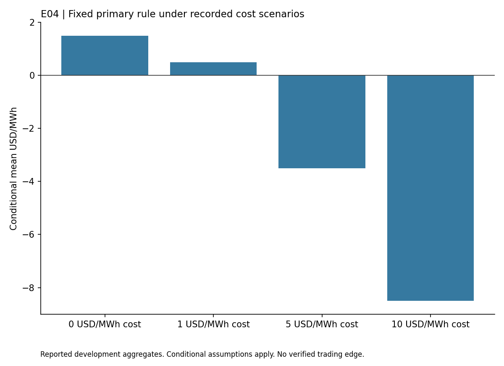

# NYISO Virtual Spread

## Findings

This study tested a fixed rule for taking a position in the difference between NYISO day ahead and real time settlement prices. The signal used the median of seven prior observations for the same local hour. It was evaluated on Q1 2023 development data.

The primary rule produced 21,543 hypothetical MWh positions across 90 delivery days. Its mean gross result was $1.50/MWh. After the assumed $5/MWh cost, the mean was -$3.50/MWh. The recorded 95% interval from a seven day block bootstrap was approximately -$6.30 to -$0.45/MWh.

The design failed its development criterion. Actual clearing, complete charges and the signal's point in time availability were not established, so even the conditional result should not be read as an executable account return. Q2 2023 remains sealed.

## Reading this report

This public copy contains the findings of one completed development study. Its chart uses only the small aggregate table in [findings.json](findings.json). The original research history, raw observations, source datasets and reserved confirmation periods remain private. This copy does not reproduce a historical backtest or establish an independently confirmed strategy.

Install matplotlib in your own Python environment, then run `python plot_results.py` to regenerate the chart. The script reads the saved table and makes no network requests. These are reported findings from the original study, not a fresh evaluation. Passing an integrity check or reproducing this chart does not validate profitability.

The [public file manifest](PUBLIC_FILES.json) records hashes of the report, aggregate table, chart script and figure. This copy was prepared without the original Git history so personal commit email addresses are not exposed. It grants no rights to underlying third-party datasets.
